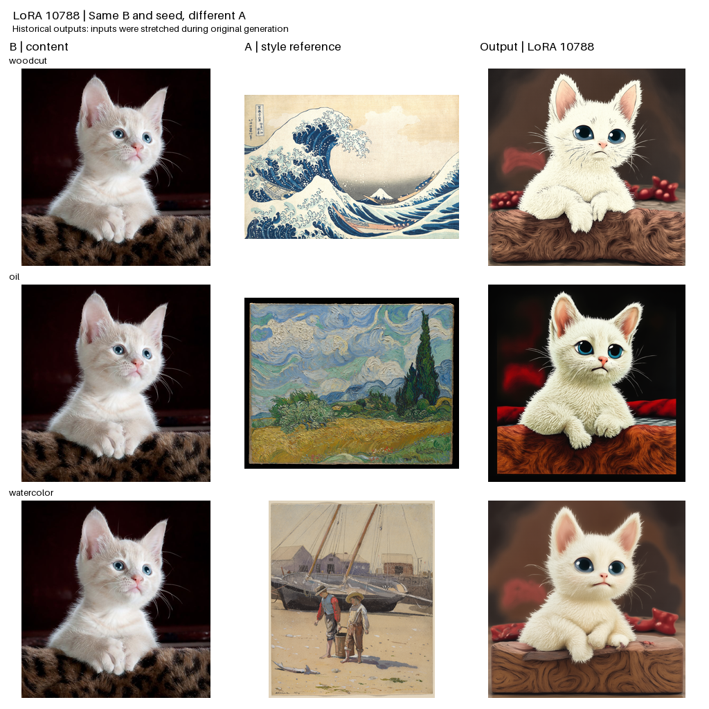
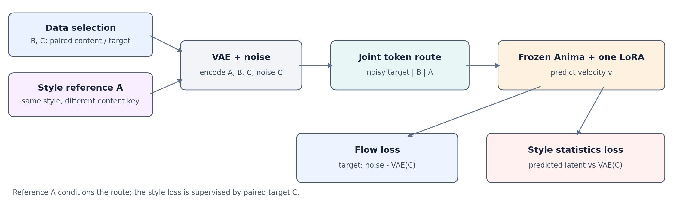

<div align="center">

# Anima Single-LoRA Style Transfer

**Reference-guided style transfer with one LoRA**  
输入内容图 B 和参考图 A，在冻结的 Anima 上探索画风迁移与内容保持。

[Project Page](https://lightlanguage1.github.io/anima-single-lora-style-transfer/) · [Research PDF](Anima_Single_LoRA_Research.pdf) · [Model / 10788 LoRA](https://github.com/lightlanguage1/anima-single-lora-style-transfer/releases/tag/v0.1.0-10788) · [ComfyUI Workflow](comfyui_node/workflow.json) · [中文说明](comfyui_node/README.md)

**Built on NVIDIA Cosmos**



*固定内容与种子，更换画风参考的实际结果。参考能改变输出，但这组示例不能证明笔触完全匹配或内容与画风已经解耦。*

</div>

## Overview

这是一个 Anima 画风迁移研究项目：单张内容图 **B** 、单张画风参考 **A** 和固定任务提示词进入项目的原生三槽路径，一个 rank-32 LoRA 调整冻结底模的输出。训练时使用额外的配对目标 C。仓库提供节点、权重、训练记录、实验图和研究论文，保留有效响应与失败案例。

- **单 LoRA：** 28 个 Transformer block、10 类投影；不是标准 LoRA Loader 的独立工作流。
- **实测节点：** RTX 3080 20 GiB，1024×1024、30 步，一次冷加载执行约 78.64 秒；这是单机记录，不是最低配置或速度保证。
- **当前结果：** 更换 A 会改变输出，但厚涂、水彩等细粒度媒介和笔触尚不稳定。完整训练数据与全部计划评测未在本仓库中重现。

## Updates

- **2026-11-07** · 发布 10788 LoRA、CircleStone 与 NVIDIA 许可附件及 ComfyUI 推理工作流。
- **2026-11-07** · 发布项目页面、训练记录与研究稿；节点使用随附的兼容推理代码和 tokenizer。

## Quick Start

### 1. Install the node

克隆本仓库，把 `comfyui_node/` 整个目录复制到 `ComfyUI/custom_nodes/AnimaSingleLoRA/`，保留其中 `runtime/` 和 `native_support/`。在 **ComfyUI 所使用的 Python 环境** 安装节点缺少的依赖：

```bash
python -m pip install -r /path/to/ComfyUI/custom_nodes/AnimaSingleLoRA/requirements.txt
```

命令中的 `python` 和路径需换成你实际的 ComfyUI 环境。请使用与本机 CUDA 匹配的 PyTorch/torchvision；仓库的 `requirements.txt` 不会替换它们。重启 ComfyUI 后，在 `Anima/Research` 中找到 **Anima · 内容 B + 画风 A（单 LoRA）** 。

### 2. Download the models

| 文件 | 获取方式 | 节点字段 |
|---|---|---|
| 本项目 `lora84_010788.safetensors` | [10788 LoRA Release](https://github.com/lightlanguage1/anima-single-lora-style-transfer/releases/tag/v0.1.0-10788) | `lora_file` |
| Anima Base V1.0 | [官方模型目录](https://huggingface.co/circlestone-labs/Anima/tree/main/split_files/diffusion_models) | `base_model` |
| Qwen Image VAE | [官方 VAE 目录](https://huggingface.co/circlestone-labs/Anima/tree/main/split_files/vae) | `vae_model` |
| Qwen 0.6B 文本编码器 | [官方文件](https://huggingface.co/circlestone-labs/Anima/blob/main/split_files/text_encoders/qwen_3_06b_base.safetensors) | `text_encoder` |

模型文件可放在你选择的位置，在节点中填写实际路径即可。权重不包含在 Git 仓库正文中；请分别阅读下载页面及 Release 的许可证。不同底模版本的兼容性尚未全面测试。

10788 权重的 SHA-256：

```text
20ab06331e98cc99d02132a84dbb20c9570c0499bb603ea669a42aa289a7fa24
```

### 3. Run in ComfyUI

1. 导入 [workflow.json](comfyui_node/workflow.json)，选择内容图 B 和画风图 A。
2. 在节点中填写上表四个权重文件的路径；`project_code_directory` 和 `runtime_directory` 留空即可使用随附代码。
3. 选择支持 BF16 的 NVIDIA CUDA 设备并运行。默认 1024×1024、30 步；`pad` 等比补边，`center_crop` 等比裁剪。

节点目前每路只支持一张图，使用固定任务提示词。上面的四节点工作流已通过 ComfyUI `PromptExecutor` 完整出图；GUI 中手动拖放工作流尚未单独验证。[完整安装、参数与故障排查](comfyui_node/README.md)。

## How it works

<p align="center"></p>

训练中，配对内容 B 与目标 C 来自记录中的样本；A 与 C 使用同一风格标签、不同内容键。VAE 编码后的三个输入经过联合 token 路由，单个 LoRA 作用于冻结 Anima。模型预测与 C 的流匹配目标，画风项比较预测 latent 与 C 的多尺度统计；**画风项并不直接逐块对齐 A 的笔触** 。训练日志中记录的 0.15 是画风/flow 加权梯度范数比控制目标，并非固定画风 loss 权重。

[训练代码与配置](training/README.md) · [公式、算子与完整实验](Anima_Single_LoRA_Research.pdf) · [实验数据](data/README.md)

## Experiments & Limitations

- **训练：** 从 9999 继续，计划最多 1,000 次更新，现有日志记录 789 次（到 10788）；有效 batch 16、1024 分辨率。
- **外部测试：** 已有 600 条记录，原计划为 1,232 条；其中 138 张构成 3 个内容 × 23 张参考 × 2 个种子的匹配子集。它们不是独立的泛化成功率。
- **内容与风格：** 输入分槽以及参考图替换造成的输出变化，不证明表征完全解耦。像素跨集检查在该轮中是关闭的；底模是否见过相似画风未知。
- **局部纹理与阶段拟合：** 部分代理指标下降，但视觉对照未稳定重现参考笔触。与其他方法尚未完成同协议公平比较。

[展示页面](https://lightlanguage1.github.io/anima-single-lora-style-transfer/)包含更多原图对照、分支实验、训练曲线、张量分布和失败案例。

## Reproduction & Hardware

本次续训记录为 NVIDIA RTX 6000D（可见约 83.05 GiB）、PyTorch 2.12.0+cu130、CUDA 13.0；CPU、操作系统、驱动及容器镜像版本未可靠留存。推理快照包含节点依赖，但完整训练复现还需要原始数据、完整训练库及匹配的 9999 训练状态。详细说明见 [training/README.md](training/README.md) 和 [模型哈希附录](MODEL_PROVENANCE.md)。

## License & Attribution

- **项目原创代码：** [Apache-2.0](LICENSE)。第三方源码和 tokenizer 保留各自许可证及版权声明。
- **10788 LoRA：** CircleStone Anima 的衍生模型；适用 [CircleStone Non-Commercial License v1.2](model_licenses/CircleStone_Anima_License.md) 及适用的 [NVIDIA Open Model License](model_licenses/NVIDIA_Open_Model_License.pdf)，具体条款和署名见 [10788 NOTICE](model_licenses/NOTICE_10788.md)。代码的 Apache-2.0 不适用于模型权重。
- **训练数据：** [StyleExpert 官方数据集](https://huggingface.co/datasets/HH-LG/StyleExpert)数据卡标注 CC BY-NC 4.0；历史本地归档的确切来源版本未独立核实。
- **图像：** 来源见 [image_sources.json](data/image_sources.json)。[更多第三方声明](THIRD_PARTY_NOTICES.md)。

本项目为独立研究，不是 CircleStone 或 NVIDIA 的官方产品。**Built on NVIDIA Cosmos.**

## Citation

研究稿与代码可在引用时链接至本仓库及 [Research PDF](Anima_Single_LoRA_Research.pdf)。作者、单位与正式论文引用信息尚未填写；请勿将本项目误标为已发表论文。
