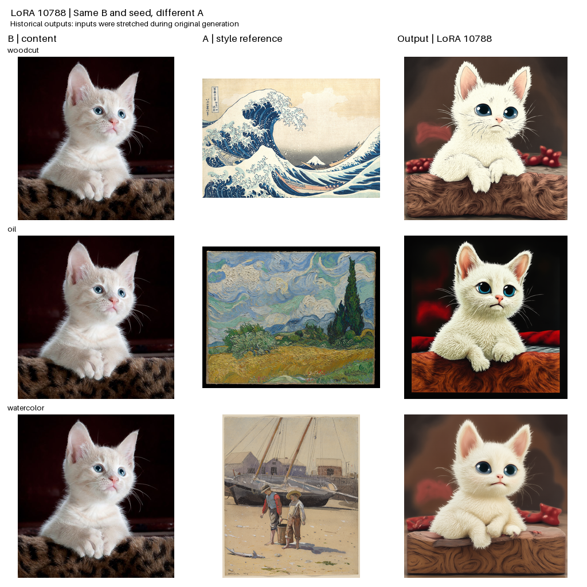
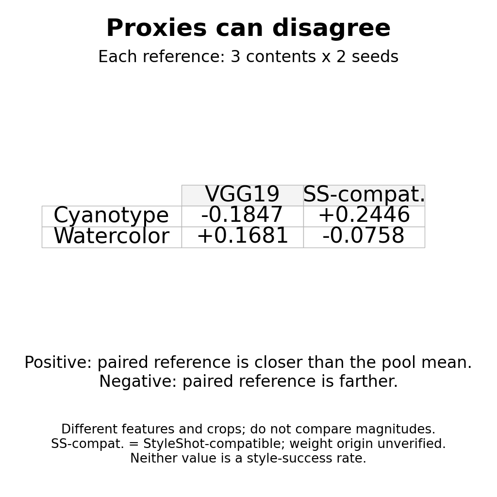
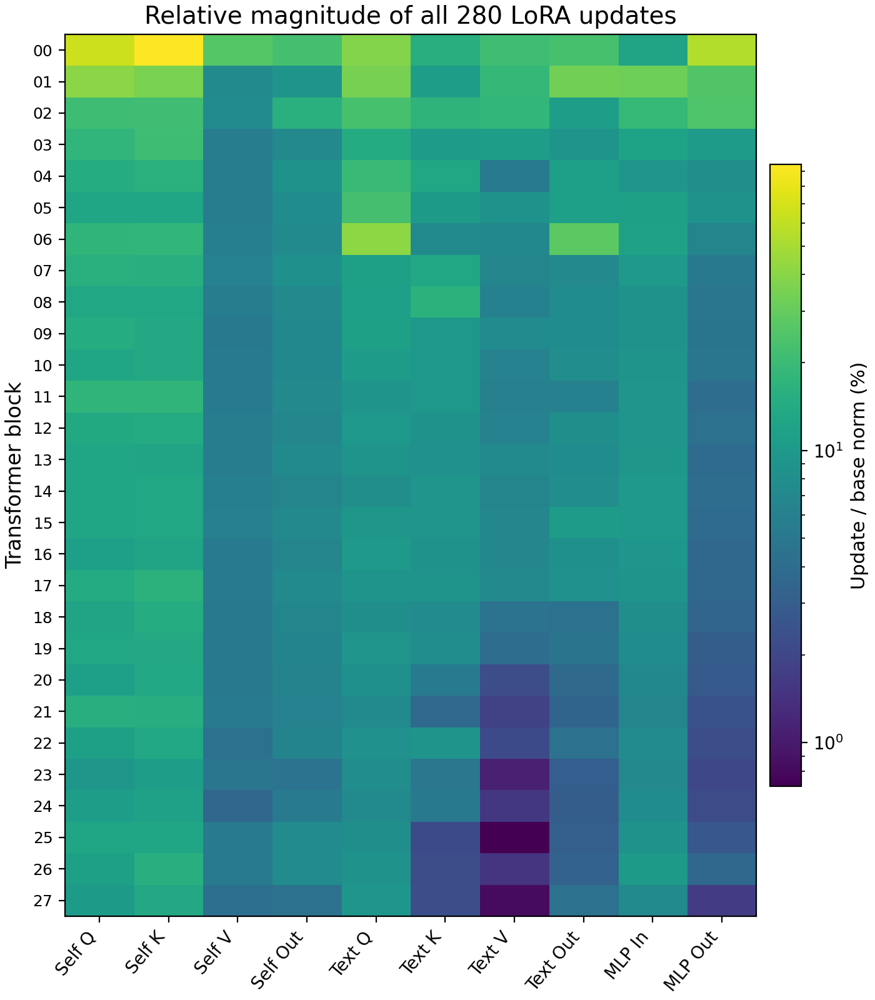
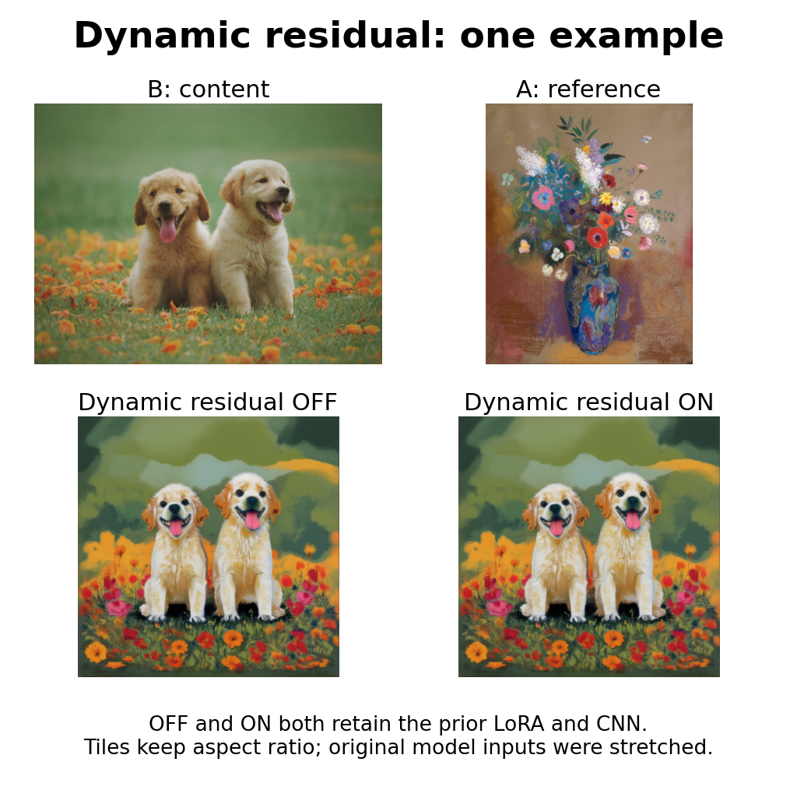
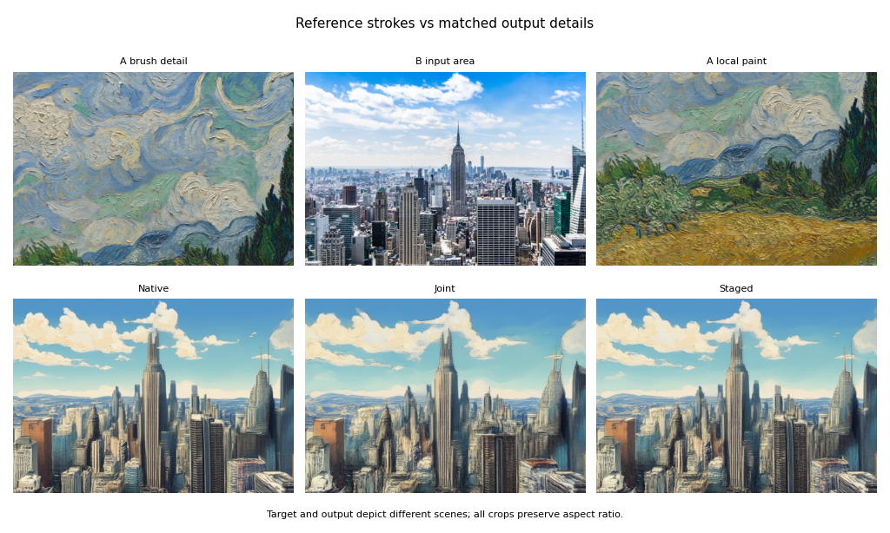
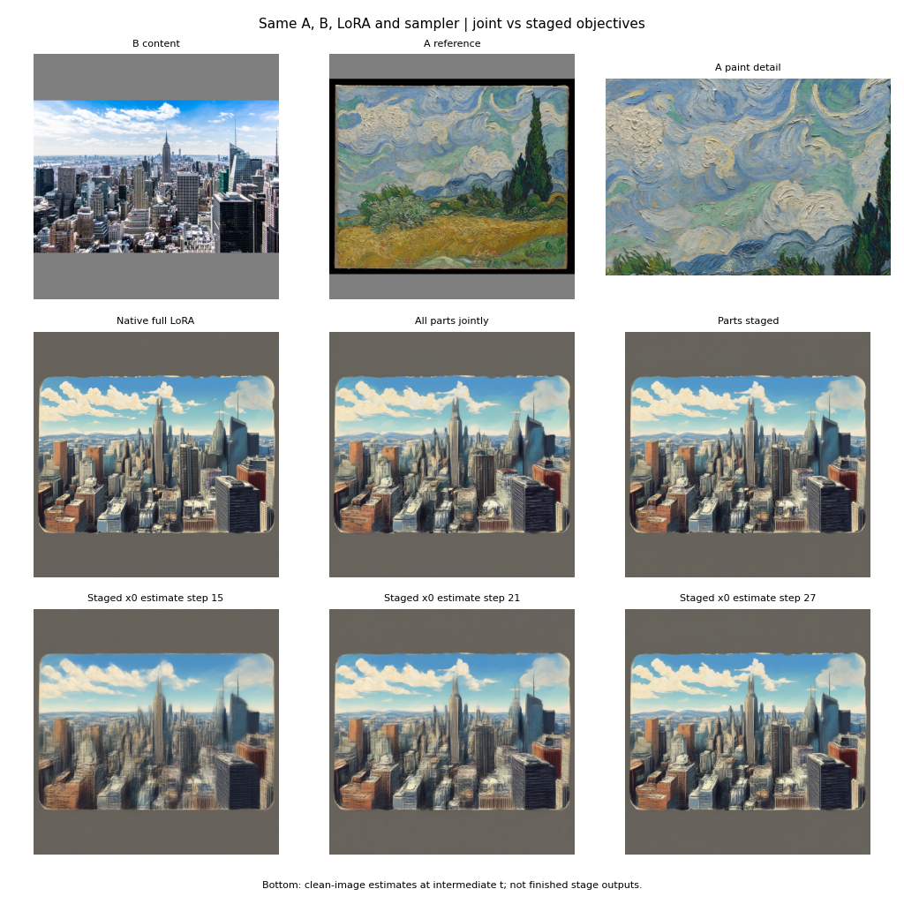

# 单个 LoRA 的参考画风迁移：纹理泛化的诊断研究

**英文论文：** Reference-Guided Style Transfer with a Single LoRA: A Diagnostic Study of Texture Generalization  
**作者与单位：** 待填写  
**文稿状态：** 本地研究草稿；尚未投稿。本文是英文论文的中文审阅版，完整实验协议和附录见 [英文 LaTeX 正文](main.tex)。

## 本次补充：数据、设备和可复现性

- 训练数据是事先构建的 StyleExpert 数据集；按文件名匹配 B/C，并从同画风标签、不同内容键中抽取 A。不同内容键不保证语义独立。项目没有留存新增人工标注或人工质量评估的证据；逐像素跨集检查在当次运行中被关闭。[官方数据集及许可](https://huggingface.co/datasets/HH-LG/StyleExpert)。
- 9999 至 10788 的实际日志有 789 次更新，每次累计 16 行；1024 分辨率、rank 32、冻结底模。训练脚本及经过路径脱敏的[参数模板](training/launch_parameters.template.json)已整理进 [training 目录](training/README.md)。
- 记录到单卡 NVIDIA RTX 6000D（可见 83.05 GiB）、PyTorch 2.12.0+cu130 与 CUDA 13.0；CPU、系统、驱动和镜像摘要没有可靠记录。模型文件本地 SHA-256 列于英文论文附录，不能冒充未记录的云端训练时哈希。
- [训练路径图](figures/training_route.png)说明 B、A 与目标 C 的输入、冻结底模和单 LoRA，以及流匹配与画风统计两个损失。画风统计的直接目标是 C，A 通过条件路径影响生成。
## 摘要

我们研究一个以冻结的 Anima 为底模、通过单个低秩适配器使用内容图 B 与画风参考图 A 的系统。问题不是模型能否改变图像颜色，而是它能否在保持 B 的内容时，可靠地重现 A 的笔触和材质。我们复核训练目标，分析 560 个 LoRA 因子、280 个更新矩阵、138 张匹配生成图和 174 次受控单步前向，并复盘卷积、局部纹理和阶段拟合实验。

参考图替换会改变模型的隐藏状态和预测结果，但这只能说明模型对参考条件有响应，不能证明内容与画风完全解耦。一个具体的 latent 转置测试显示：输入发生明显改变，现有风格统计损失仍接近零。最新的单张油画参考实验中，颜色、方向和局部纹理代理有所下降，但图片没有明显重现参考的厚涂笔触。这些结果指出监督和测量的局限；它们不能单独确定泛化失败的唯一根因，也不能给出通用的成功率。

## 1. 问题与系统

我们希望参考图 A 提供画风，内容图 B 提供人物或场景；训练时还使用与 A 同风格标签、不同内容组的配对目标 C。三个输入槽经联合注意力交换信息，所以输入位置分开本身不等于已经学会分离。

底模冻结，训练 1 个 rank-32 LoRA。模型在 28 个 block 的 10 类投影上加入低秩增量：

\[
Wx\;\longrightarrow\; Wx+U(Dx),\qquad \Delta W=UD.
\]

10788 检查点对应 560 个因子张量、280 个组合更新矩阵和 45,875,200 个 LoRA 参数。本工作研究这些增量的统计分布和输入响应，但矩阵大小或有效秩不能直接等同于画风贡献。

*图 1：固定内容和种子，更换参考 A 后，渲染会发生变化；这组回顾性示例不能证明忠实重现了参考媒介。历史生成输入曾被强制拉伸为正方形。*

## 2. 实际训练目标

记 VAE 编码为 \(z_C\)，噪声为 \(\epsilon\)，模型预测流速为 \(v_\theta\)。实际训练路径为：

\[
z_t=(1-t)z_C+t\epsilon,\quad v^*=\epsilon-z_C,\quad
\widehat z_0=z_t-t v_\theta.
\]

\[
\mathcal L=\lambda_f\,\mathcal L_{\rm flow}+\lambda_s\,\mathcal L_{\rm style}.
\]

画风损失比较 \(\widehat z_0\) 与**配对目标 C** 的多尺度 latent 通道相关矩阵、均值、标准差和边缘统计；它并没有逐块比较输出与 A 的真实笔触。换言之，A 作为条件输入参与预测，但现有损失监督的直接参照是 C。

这一轮训练配置的 flow 权重为 1.25；画风权重由控制器调整，实际记录范围约为 0.07684–0.12110。常被提到的 **0.15 是加权画风梯度范数与加权主梯度范数的目标比值，不是固定画风 loss 权重**。日志中只有 25 次稀疏梯度审计，且审计项标为估计值，不能当作 789 次逐步精确测量。

## 3. 数据与评测范围

| 已留存实验 | 实际范围 | 解读边界 |
| --- | --- | --- |
| 9999 继续训练至 10788 | 789 次更新，12,624 条样本呈现；涉及 1,675 个内容 ID、10,890 个参考路径和 140 个风格标签 | 不是计划数据量 46,046 对都在本轮出现 |
| 标签划分 | 训练/验证/测试为 140/30/37 个标签，标签名无交集 | 不证明画风视觉上独立，也无法确认底模预训练未见过 |
| 综合出图档案 | 计划 1,232 张，实际存有 600 条记录及对应图 | 不能把 1,232 当成已完成量 |
| 10788 匹配子集 | 3 个内容 × 23 张参考 × 2 个种子，共 138 张 | 图片共享内容与参考，不是 138 个独立风格 |
| 条件响应 | 174 次固定状态单步前向，28 层、3 个输入槽 | 不是完整去噪轨迹 |
| A 分解与阶段拟合 | 1 张 A、1 张 B、1 个种子；联合/阶段两组 | 是机制试验，不能计算泛化成功率 |

数据记录和逐项来源见 [数据说明](data/README.md) 与 [论文项目说明](README.md)。归档数据包含审计表、训练日志导出、评测清单和实验代理数值；原始底模、LoRA 权重和训练图片未装入数据包。

## 4. 现有模型到底学到了什么

在 138 张匹配子集中，使用 1,168 维 VAE 统计描述符比较输出：固定 B 和种子、更换 A 的配对距离中位数为 0.3469；更换 B 为 0.7268；更换种子为 0.3831。该描述符包含颜色、边缘、对象和布局信息，所以这些数值只能表示**描述符变化**，不能作为画风迁移分离度或成功率。

同样，受控单步前向中替换 A 会改变目标槽和最终流速；历史 2×2 条件干预中，四组错误参考相对匹配参考的 flow MSE 增量均为正。这支持模型确实使用了参考条件，却不保证它使用的是笔触而非颜色或语义。VGG19 与 StyleShot 兼容编码器在个别参考上的判断也不一致，说明单个代理分数不足以替代图像检查。

*图 2：不同特征代理会给出不同的参考接近度判断；它们的输入裁剪与数值尺度也不同。*

在 280 个更新矩阵中，\(\|\Delta W\|_F/\|W\|_F\) 的中位数为 8.25%，有效秩中位数为 7.35/32。9999 与 10788 的更新方向余弦相似度中位数为 0.98765。这些是权重结构的描述，不能解释为输出图像“贡献了 8.25% 的画风”。

*图 3：28 个 block × 10 类投影的更新范数比例。颜色表示参数统计，不代表某一层就是专门的画风层。*

## 5. 为什么损失变小仍可能没有笔触

设 \(F\) 为通道 × 空间的特征矩阵，\(P\) 为空间置换，归一化通道 Gram 为 \(G(F)=\widetilde F\widetilde F^\top/N\)。则

\[
G(FP)=\widetilde FPP^\top\widetilde F^\top/N=G(F).
\]

因此，全局通道相关性本身不保留每个局部特征的空间位置。在一个实际的方形 latent 转置测试中，latent 的相对 RMS 变化为 1.16，而实现中的画风损失为 \(5.96\times10^{-14}\)。这说明该损失存在一个具体盲区；转置不是自然图片里的画风变化，也不能据此断言整个模型失败只由这一项造成，flow 损失也可能提供其他约束。

局部卷积分支经历 30 次本地更新、追加 270 次本地更新和 600 次云端更新；600 步记录覆盖 9,600 个不同采样对、140 个风格标签。云端第 0/400/600 步的预览分别对应累计 300/700/900 步，未确立外部笔触的稳定改善；其中固定参考裁剪只覆盖约 25% 面积，遗漏了中心 \(256\times256\) 区域。后续动态残差用 12 组内容/参考进行 ON/OFF 对照，出现了一些粉彩边缘与墨纸感，但点彩和蓝晒案例仍失败且存在内容漂移。OFF 仍保留原 LoRA 和旧卷积分支，因此不能解释为“无任何参考模块”。

*图 4：动态增量的回顾性示例；新增分支关闭时，旧卷积和 LoRA 仍在。单张正例不能代表所有风格。*

## 6. 把目标分解后再拟合：最新单例

我们从一张油画 A 提取三个目标代理：RGB 颜色直方图、灰度 VGG 特征的方向变化、局部 VGG patch 距离。它们会受主体轮廓、亮度和内容影响，**不是已证实彼此独立的“颜色、笔触、质感原子”**。

在同一个 LoRA 内，先根据原始 A 和模糊 A 的响应选出部分谱方向，再保留其余方向作为互补部分。两条路径使用同一 A、B、种子、1024 等比补边和 30 步 Euler 采样；联合路径每次同时考虑三个代理，阶段路径依次加入代理。两条路径的额外候选计算量相同，但原始基线计算量更低。这个实验没有更新模型参数。

| 路径 | 颜色误差 | 方向误差 | 局部纹理误差 |
| --- | ---: | ---: | ---: |
| 原始 LoRA | 0.04381 | 0.01173 | 0.11174 |
| 联合拟合 | 0.04234 | 0.00979 | 0.10036 |
| 阶段拟合 | 0.04321 | 0.01055 | 0.10407 |

表中越低只表示对应代理更接近参考，不表示视觉上更成功。实际决策多数对两个互补分组同时选择 +0.35；精确算术下等于把图像侧 LoRA 更新统一放大到 1.35 倍，实际 BF16 计算存在舍入误差。第一决策点两组扰动的三维代理响应余弦为 0.9915；这说明该点上两个响应接近，**不说明整个 LoRA 的画风空间是一维**。

*图 5：油画局部与城市内容、原始/联合/阶段结果的对照。联合拟合和阶段拟合的三项代理误差均低于原版，但视觉上未清楚重现参考的厚涂曲线笔触。参考和输出主体不同，不能简单逐像素对齐。*

*图 6：完整输入和结果。阶段中间图是单步估计经 VAE 解码的预览，不是已经完成的中间阶段生成图。*

## 7. 结论与下一步

现有证据显示，这个单 LoRA 会使用 A，部分情况下可以迁移颜色和粗略渲染；但对细笔触、材料肌理和内容保持的效果不稳定。原有统计目标存在可计算的空间盲区；新增局部代理也可能因内容和轮廓混入而获得较好分数，却没有带来对应的笔触改善。单纯增加步数、扩大 LoRA 或继续抬高权重，均未被现有数据证明是独立有效的解决方案。

下一项实验应先验证局部描述符：对同风格不同内容，是否比同内容不同风格给出更近的距离；随后才在固定输入、种子和计算预算下，对单 LoRA 的训练方法做成对比较，并保留原始分辨率局部图、独立未见参考和人工评审。这个顺序先检验“监督到底在量什么”，再检验模型是否学会。

**开放问题：** 现存档案不是完整的 1,232 图评测；尚无严格封存的独立基准、盲评或与其他模型同协议的公平重跑。部分历史输入经过正方形拉伸。作者、图片许可和公开数据包需确认后才能投稿。

## 参考文献与相关工作

1. Gatys 等，[A Neural Algorithm of Artistic Style](https://arxiv.org/abs/1508.06576)，2015。
2. Hu 等，[LoRA: Low-Rank Adaptation of Large Language Models](https://arxiv.org/abs/2106.09685)，2021。
3. Lipman 等，[Flow Matching for Generative Modeling](https://arxiv.org/abs/2210.02747)，2022。
4. Gao 等，[StyleShot: A Snapshot on Any Style](https://arxiv.org/abs/2407.01414)，2024。
5. Li 等，[Computational Decomposition of Style](https://arxiv.org/abs/1811.08668)，2018。
6. Su 等，[Compositional Image Decomposition with Diffusion Models](https://arxiv.org/abs/2406.19298)，2024。
7. Wu 等，[USO: Unified Style and Subject-Driven Generation](https://arxiv.org/abs/2508.18966)，2025。

参考工作提供方法背景；由于没有采用同一输入、预算和协议重跑，本文没有与这些方法进行性能优劣的定量结论。
